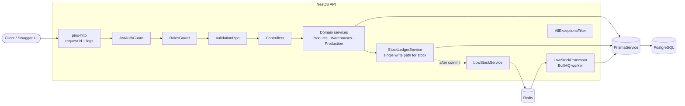
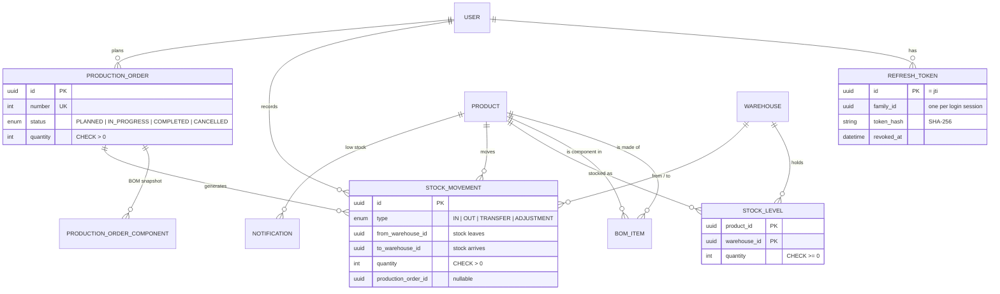
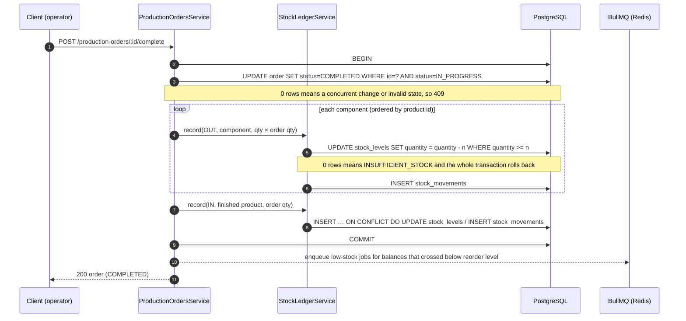

# NestJS Inventory & Production ERP API

A production-style REST backend for multi-warehouse inventory and light manufacturing: an immutable stock ledger whose balances can never go negative, BOM-driven production orders, and asynchronous low-stock alerts, secured with JWT rotation and role-based access control.

[](https://github.com/eshginfarzali/nestjs-inventory-erp-api/actions/workflows/ci.yml)
[](LICENSE)


---

## Contents

- [Features](#features)
- [Tech stack](#tech-stack)
- [Architecture](#architecture)
- [RBAC permission matrix](#rbac-permission-matrix)
- [Getting started](#getting-started)
- [Scripts](#scripts)
- [Testing](#testing)
- [API overview](#api-overview)
- [Project structure](#project-structure)
- [Roadmap](#roadmap)
- [License](#license)

## Features

**Inventory**

- Products (SKU, unit, reorder level, soft delete) and warehouses (soft delete, only when empty).
- Stock movements `IN`, `OUT`, `TRANSFER`, `ADJUSTMENT` recorded in an append-only ledger, with a per-product, per-warehouse balance table.
- **Stock can never go negative.** Every movement runs in one database transaction; withdrawals use a conditional `UPDATE … WHERE quantity >= n`, so concurrent requests cannot oversell, and a `CHECK (quantity >= 0)` constraint backs this up in PostgreSQL. An e2e test fires 10 parallel withdrawals at the same balance and asserts exactly the affordable number succeed.
- Transfers move stock between warehouses atomically; row locks are taken in a deterministic order to avoid deadlocks between opposite transfers.

**Production**

- Bill of materials per product (`PUT /products/:id/bom`), with validation against self-references, duplicates and indirect cycles.
- Production orders follow `PLANNED → IN_PROGRESS → COMPLETED`, with `CANCELLED` reachable from both open states. Invalid transitions return `409 INVALID_STATUS_TRANSITION`.
- The BOM is snapshotted onto the order when it is planned. Completing an order issues every component (`OUT`) and receives the finished goods (`IN`) in **one** transaction, all linked to the order. If any component is short, nothing changes and the order stays `IN_PROGRESS`.

**Low-stock alerts (BullMQ + Redis)**

- When a movement takes a balance from at or above the product's reorder level to below it, a job is enqueued **after** the transaction commits. Alerts are not repeated while the level stays low; a reorder level of 0 turns them off.
- A BullMQ worker (3 attempts, exponential backoff) stores an in-app notification and logs a warning. Managers read and acknowledge alerts through `/notifications`.

**Security**

- JWT access tokens (15 min by default) plus refresh tokens (7 days) signed with **separate secrets**.
- Refresh tokens are **rotated** on every use. Only their SHA-256 hash is stored, and each login session is a token _family_. Replaying an already-rotated token revokes the whole family (theft detection). Logout revokes the session, and deactivating a user or changing their role revokes all of that user's refresh tokens.
- Passwords are hashed with **argon2id**. Login runs a dummy verification for unknown e-mails so response timing does not reveal which accounts exist.
- A global `JwtAuthGuard` applies deny-by-default auth (`@Public()` opts out), and a global `RolesGuard` checks `@Roles(...)`.

**Platform**

- Swagger/OpenAPI at `/docs` (JSON at `/docs/openapi.json`) with bearer auth and typed paginated responses.
- Structured JSON logging with `nestjs-pino`, request ids (`x-request-id` propagated or generated), and redaction of `Authorization` and cookies. Logs are pretty-printed in development.
- `GET /health` (`@nestjs/terminus`) checks PostgreSQL and Redis.
- Global `ValidationPipe` (whitelist, forbid unknown fields, transform). Every error has one JSON shape, with stable machine-readable `code`s for business errors. Prisma errors map to proper HTTP statuses: unique violations return `409`, not `500`.
- Pagination (`page`, `limit` ≤ 100) on every list endpoint, returning `{ data, meta: { page, limit, total, totalPages } }`.
- Environment validated at start-up (`@nestjs/config` + class-validator). The app refuses to boot with missing or weak settings, such as a JWT secret shorter than 32 characters.

## Tech stack

| Concern            | Choice                                                                      |
| ------------------ | --------------------------------------------------------------------------- |
| Runtime / language | Node.js 24, TypeScript 6 (`strict`)                                         |
| Framework          | NestJS 12 (Express 5 platform)                                              |
| Database / ORM     | PostgreSQL 17, Prisma 7 (`prisma-client` generator + `@prisma/adapter-pg`)  |
| Queue              | BullMQ 6 on Redis 7 (`@nestjs/bullmq`)                                      |
| Auth               | `@nestjs/jwt`, argon2                                                       |
| Docs               | `@nestjs/swagger` (OpenAPI 3)                                               |
| Logging / health   | `nestjs-pino` (pino 10), `@nestjs/terminus`                                 |
| Testing            | Jest 30 + ts-jest, Supertest, Testcontainers (PostgreSQL + Redis)           |
| Quality            | ESLint 10 + typescript-eslint (type-checked rules, zero warnings), Prettier |
| Delivery           | Multi-stage Dockerfile (non-root), docker compose, GitHub Actions           |

> **Why Node 24?** NestJS 12 packages are ESM-only while this app compiles to CommonJS. That works at runtime through `require(esm)`, but Jest (run with `--experimental-vm-modules`) needs Node ≥ 24.9 for it. CI, Docker and `.nvmrc` therefore all use Node 24.

## Architecture

### Request flow and components



- **`StockLedgerService` is the only code that changes stock.** It takes the caller's transaction client, so a production order's status change, component consumption and output receipt all commit or roll back together.
- Low-stock jobs are enqueued **after** the transaction commits, so a rolled-back movement can never trigger an alert. Enqueue failures are logged and do not fail the request, because the movement is already committed. A transactional outbox would close this gap (see [Roadmap](#roadmap)).
- The BullMQ worker runs in the API process for simplicity. It can be moved to a separate deployment without code changes to the producer.

### Data model



Ledger convention: `quantity` is always positive and the direction is given by `from`/`to`. `IN` has only `to`, `OUT` has only `from`, `TRANSFER` has both (and they must differ), and `ADJUSTMENT` has exactly one. A database `CHECK` constraint enforces this shape, and the service validates it first so clients get a `400` instead of a database error. All invariants are in [`prisma/migrations`](prisma/migrations).

### Completing a production order



## RBAC permission matrix

Roles: `ADMIN`, `MANAGER`, `OPERATOR`. Routes without `@Roles()` are open to any authenticated user. `401` means the request is not authenticated; `403` means the user is authenticated but lacks the role.

| Endpoint                                                          | ADMIN  | MANAGER | OPERATOR |
| ----------------------------------------------------------------- | :----: | :-----: | :------: |
| `POST /auth/login`, `POST /auth/refresh`, `GET /health`, `/docs`  | public | public  |  public  |
| `POST /auth/logout`, `GET /auth/me`                               |  yes   |   yes   |   yes    |
| `POST/GET/PATCH /users`                                           |  yes   |    –    |    –     |
| `GET /products`, `GET /products/:id`, `GET /products/:id/bom`     |  yes   |   yes   |   yes    |
| `POST /products`, `PATCH /products/:id`, `PUT /products/:id/bom`  |  yes   |   yes   |    –     |
| `DELETE /products/:id` (deactivate)                               |  yes   |    –    |    –     |
| `GET /warehouses`, `GET /warehouses/:id`                          |  yes   |   yes   |   yes    |
| `POST /warehouses`, `PATCH /warehouses/:id`                       |  yes   |   yes   |    –     |
| `DELETE /warehouses/:id` (deactivate, only when empty)            |  yes   |    –    |    –     |
| `POST /stock-movements/in`, `/out`, `/transfer`                   |  yes   |   yes   |   yes    |
| `POST /stock-movements/adjustment`                                |  yes   |   yes   |    –     |
| `GET /stock-movements`, `GET /stock-levels`                       |  yes   |   yes   |   yes    |
| `POST /production-orders`, `POST /production-orders/:id/cancel`   |  yes   |   yes   |    –     |
| `POST /production-orders/:id/start`, `/complete`, `GET` endpoints |  yes   |   yes   |   yes    |
| `GET /notifications`, `PATCH /notifications/:id/read`             |  yes   |   yes   |    –     |

This matrix is checked by [`test/rbac.e2e-spec.ts`](test/rbac.e2e-spec.ts).

Access tokens are stateless, so a role change or deactivation reaches existing access tokens only when they expire (at most `JWT_ACCESS_TTL`, 15 min by default). The user's refresh tokens are revoked immediately, so they cannot get a new access token.

## Getting started

### Prerequisites

- Node.js **24** (`nvm use` reads `.nvmrc`) and npm
- Docker (for docker compose and for the e2e tests)

### Configuration

All settings come from environment variables and are validated at start-up. [`.env.example`](.env.example) lists every variable with comments:

```bash
cp .env.example .env
# then set JWT_ACCESS_SECRET / JWT_REFRESH_SECRET, e.g. with: openssl rand -base64 48
```

`.env` is git-ignored. The default host ports avoid common local conflicts (API `3200`, PostgreSQL `5460`, Redis `6390`), and every one of them can be changed in `.env`.

### Option A: everything in Docker

```bash
cp .env.example .env
docker compose up --build
```

This starts PostgreSQL and Redis, then runs a one-shot `migrate` container (`prisma migrate deploy` plus the idempotent seed), then starts the API:

- API: <http://localhost:3200>
- Swagger UI: <http://localhost:3200/docs>
- Health: <http://localhost:3200/health>

Seeded demo users (password = `SEED_USER_PASSWORD` from `.env`):

| E-mail                     | Role     |
| -------------------------- | -------- |
| `admin@inventory.local`    | ADMIN    |
| `manager@inventory.local`  | MANAGER  |
| `operator@inventory.local` | OPERATOR |

The seed also creates two warehouses, three raw materials with opening stock in `WH-MAIN`, and a finished product `CABINET-STD` with a bill of materials, so you can plan, start and complete a production order straight away.

Stop and remove everything, including volumes, with `docker compose down -v`.

### Option B: API on the host, infrastructure in Docker

```bash
cp .env.example .env
docker compose up -d postgres redis
npm ci                    # also generates the Prisma client
npm run prisma:deploy     # apply migrations
npm run db:seed           # demo data
npm run start:dev         # http://localhost:3200 (watch mode, pretty logs)
```

Options A and B both use host port `3200` by default, so run one at a time or change `API_HOST_PORT` / `PORT`.

### Quick tour with curl

```bash
TOKEN=$(curl -s -X POST localhost:3200/auth/login \
  -H 'content-type: application/json' \
  -d '{"email":"manager@inventory.local","password":"ChangeMe-Demo-123"}' | jq -r .accessToken)

curl -s localhost:3200/stock-levels -H "authorization: Bearer $TOKEN" | jq
```

## Scripts

| Script                                    | Description                                                    |
| ----------------------------------------- | -------------------------------------------------------------- |
| `npm run start:dev`                       | Start in watch mode                                            |
| `npm run build` / `npm start`             | Compile to `dist/` / run the compiled app                      |
| `npm run lint`                            | ESLint with type-aware rules, `--max-warnings 0`               |
| `npm run format` / `npm run format:check` | Prettier write / check                                         |
| `npm run typecheck`                       | `tsc --noEmit` over sources, tests, seed and config            |
| `npm test`                                | Unit tests                                                     |
| `npm run test:cov`                        | Unit tests with coverage                                       |
| `npm run test:e2e`                        | E2E tests against real PostgreSQL + Redis (Testcontainers)     |
| `npm run prisma:generate`                 | Regenerate the Prisma client (also runs on `postinstall`)      |
| `npm run prisma:migrate`                  | Create/apply a migration in development (`prisma migrate dev`) |
| `npm run prisma:deploy`                   | Apply committed migrations (`prisma migrate deploy`)           |
| `npm run db:seed`                         | Idempotent demo seed                                           |

## Testing

```bash
npm test           # 83 unit tests, no infrastructure needed
npm run test:e2e   # 62 e2e tests, needs a running Docker daemon
```

**Unit tests** (`src/**/*.spec.ts`) cover the logic that matters most:

- `AuthService`: login, refresh rotation, reuse detection revoking the token family, logout, hashed storage.
- `JwtAuthGuard` / `RolesGuard`: public routes, missing/expired/foreign tokens, refresh token used as an access token, role checks.
- `StockLedgerService` and movement rules: no negative stock, exact-zero withdrawals, transfers, lock ordering, inactive products and warehouses, ledger shape per movement type.
- Production orders: the state machine, atomic completion (components out, output in), rollback on shortage, concurrent status change, BOM snapshot.
- Low-stock rule ("crossed below" semantics) and producer behaviour when Redis is down.
- BOM cycle detection, the exception filter's Prisma mapping, and environment validation.

**E2E tests** (`test/*.e2e-spec.ts`) boot the real `AppModule`. Jest's global setup starts throw-away `postgres:17-alpine` and `redis:7-alpine` containers with Testcontainers and applies the committed migrations with `prisma migrate deploy`. The suites cover:

- **Auth flow:** login, validation errors, `/auth/me`, refresh rotation and replay detection, logout, deactivated users, duplicate e-mails.
- **RBAC:** the permission matrix above, role by role, including `401` vs `403`.
- **Stock:** `OUT` cannot go negative, transfers between warehouses (including failed ones leaving both sides untouched), adjustments, 10 concurrent withdrawals, and the database `CHECK` constraint.
- **Production:** full `PLANNED → IN_PROGRESS → COMPLETED` flow with resulting stock levels, shortage rollback, cancel permissions, terminal states, BOM cycle rejection.
- **Low stock:** a job is enqueued (`Queue.add` spied) when the reorder level is crossed, the worker persists the notification, no repeat alert while the level stays low, mark-as-read.
- **Health and docs:** `/health` reports db and redis `up`, the OpenAPI document is served, request ids are propagated, 404 error shape.

CI ([`.github/workflows/ci.yml`](.github/workflows/ci.yml)) runs the same commands on Node 24: `npm ci` → `format:check` → `lint` → `typecheck` → `test` → `test:e2e` → `build`, followed by a Docker image build.

## API overview

Full, interactive documentation is in Swagger UI at `/docs`.

| Area              | Endpoints                                                                                                            |
| ----------------- | -------------------------------------------------------------------------------------------------------------------- |
| Auth              | `POST /auth/login` · `POST /auth/refresh` · `POST /auth/logout` · `GET /auth/me`                                     |
| Users             | `POST /users` · `GET /users` · `GET /users/:id` · `PATCH /users/:id`                                                 |
| Products          | `POST/GET /products` · `GET/PATCH/DELETE /products/:id` · `GET/PUT /products/:id/bom`                                |
| Warehouses        | `POST/GET /warehouses` · `GET/PATCH/DELETE /warehouses/:id`                                                          |
| Stock movements   | `POST /stock-movements/{in,out,transfer,adjustment}` · `GET /stock-movements` · `GET /stock-movements/:id`           |
| Stock levels      | `GET /stock-levels?productId=&warehouseId=`                                                                          |
| Production orders | `POST/GET /production-orders` · `GET /production-orders/:id` · `POST /production-orders/:id/{start,complete,cancel}` |
| Notifications     | `GET /notifications?unread=true` · `PATCH /notifications/:id/read`                                                   |
| Health            | `GET /health`                                                                                                        |

Error responses always have this shape:

```json
{
  "statusCode": 409,
  "error": "Conflict",
  "message": "Insufficient stock: requested 21, available 20",
  "code": "INSUFFICIENT_STOCK",
  "details": { "productId": "…", "warehouseId": "…", "requested": 21, "available": 20 },
  "path": "/stock-movements/out",
  "method": "POST",
  "timestamp": "2026-01-01T12:00:00.000Z",
  "requestId": "6f1c…"
}
```

## Project structure

```text
src/
├── auth/                 # login / refresh rotation / logout, global guards registration
├── users/                # admin user management
├── products/             # catalogue + bill of materials
├── warehouses/
├── inventory/            # StockLedgerService (single write path), movements, levels
├── production-orders/    # state machine + atomic completion
├── notifications/        # BullMQ producer, processor, notifications API
├── health/               # terminus: Prisma + Redis
├── common/               # decorators, guards, exception filter, pagination, security helpers
├── config/               # env validation + typed config service
├── logger/               # nestjs-pino options
├── prisma/               # PrismaService (driver adapter)
├── app.module.ts
├── app.setup.ts          # shared HTTP setup (Swagger, CORS, shutdown hooks)
└── main.ts
prisma/                   # schema, migrations (with CHECK constraints), seed
test/                     # e2e specs + Testcontainers global setup
```

## Roadmap

- Transactional outbox for low-stock events, so an alert is guaranteed even if Redis is down at commit time.
- Rate limiting and lockout on `POST /auth/login` (`@nestjs/throttler`).
- Idempotency keys on movement endpoints, so client retries are safe.
- Stock reservations for planned production orders, and component availability checks at start time.
- Decimal quantities and unit-of-measure conversions; lot/serial tracking.
- Run the BullMQ worker as a separate deployment; add metrics and tracing (OpenTelemetry).
- Reporting endpoints such as stock valuation and movement history exports.

## License

[MIT](LICENSE) © 2026 Eshgin Farzaliyev
